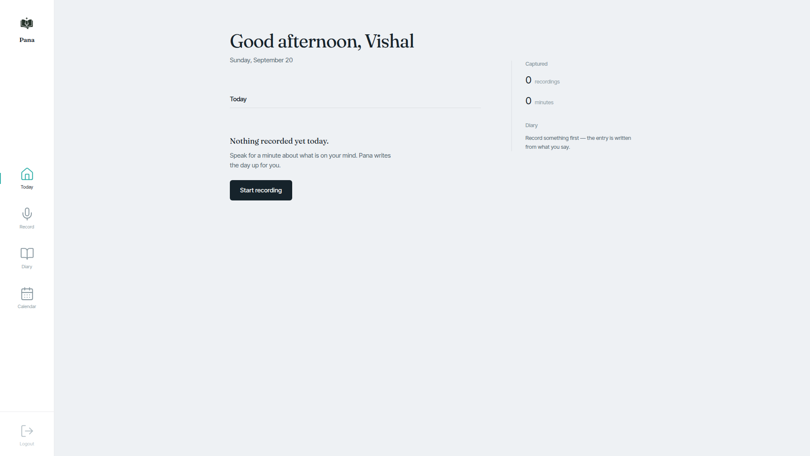
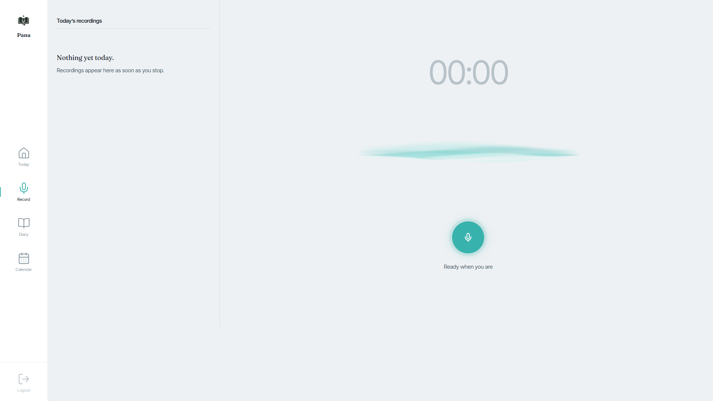
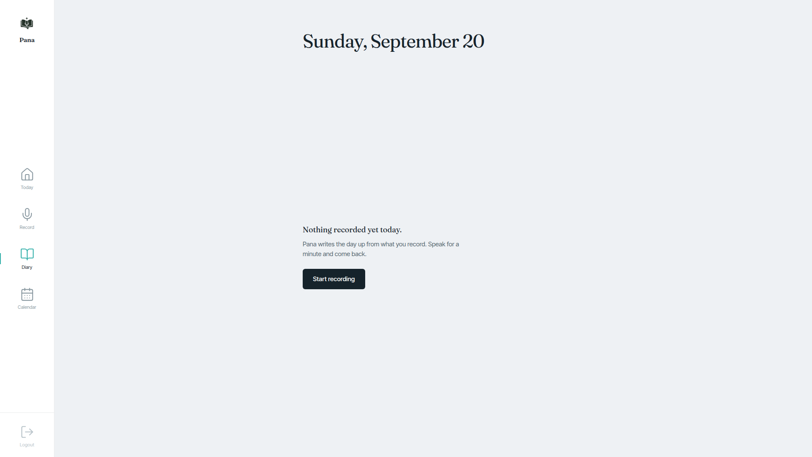
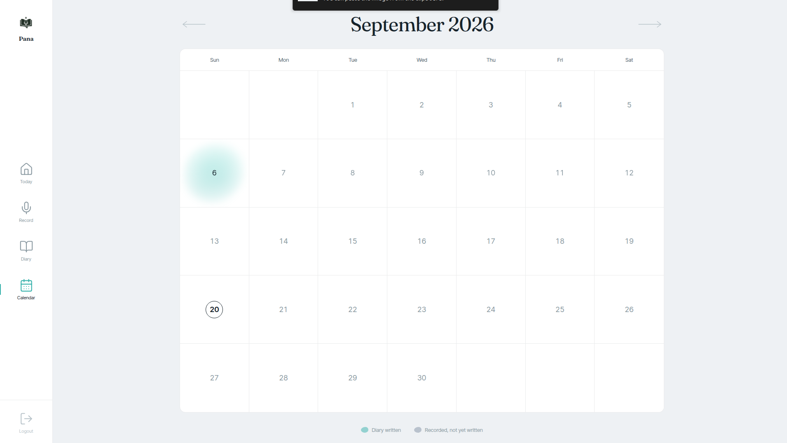
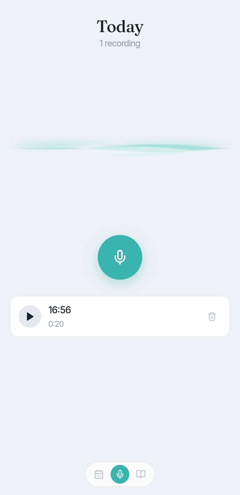

# Pana - पाना

📜 **The Page That Remembers You**

**Pana** is a voice journaling assistant that turns your raw voice notes into structured, meaningful reflections, and that you can also simply **phone and talk to**. Inspired by the Nepali word **"पाना (Pana)"**, meaning _page_, it bridges the gap between spoken thoughts and an organized personal history.

---

## 📸 A Look Inside

### Web

| Home | Recording |
| :--: | :--: |
|  |  |

| Diary | Calendar |
| :--: | :--: |
|  |  |

### Mobile

| Recording | Diary | Calendar |
| :--: | :--: | :--: |
|  |  |  |

---

## 🚀 Key Features

- **High-Fidelity Audio Capture**
  Record thoughts on the fly with real-time volume visualization.
- **Word-Level Synchronized Transcription**
  Whisper transcribes every recording, and playback highlights the transcript word by word, so you can "read" your voice.
- **Intelligent Diary Synthesis**
  An LLM reads the day's recordings and writes a cohesive diary entry with:
  - **Mood Analysis**: the emotional tone of your day.
  - **Structured Narrative**: disparate thoughts woven into one story.
  - **Action Items**: todos and reminders pulled out of your rants.
- **Interactive Calendar**
  Browse past days, see your streak, and view or regenerate the diary for any date.
- **Talk to Pana on the Phone** 📞
  Call Pana's phone number from any phone and have a spoken conversation. Pana listens, understands, and answers in a natural voice, over a real carrier SIP trunk.
- **Background Processing**
  Transcription and AI generation run asynchronously on Celery and Redis.
- **Secure & Private**
  Google sign-in, and credentials kept out of the app's environment entirely (see [Security](#-security-notes)).

---

## 🛠 Tech Stack

| Layer | Technology |
|---|---|
| Web app | React 19 (Vite), vanilla CSS, Framer Motion, Lucide icons, Axios |
| Mobile app | Capacitor build of the web app (`pana-mobile/`) |
| API | FastAPI (Python 3.12+), Pydantic, SQLAlchemy async |
| Storage | PostgreSQL, recordings on disk |
| Jobs | Celery + Redis (broker and pub/sub) |
| Transcription | Whisper (`whisper-large-v3`, served by Groq) |
| Diary LLM | Groq (`openai/gpt-oss-120b`) |
| Telephony | Asterisk (PJSIP) in Docker, SIP trunk to Nepal Telecom (NTC) IMS |
| Voice conversation | Asterisk ARI → `voice_service/`: Groq Whisper (speech-to-text) → Groq LLM → NVIDIA Magpie (text-to-speech) |

---

## 🏗 Architecture

### Journaling

1. **Capture**: the app records audio.
2. **Upload**: the API stores it on disk and creates a transcription job.
3. **Transcribe**: a Celery worker runs Whisper and streams progress back over SSE.
4. **Synthesize**: on request, the day's transcripts become a structured diary entry.
5. **Reflect**: read the diary, replay the source recordings, track action items.

### Phone conversations

```
 caller's phone
      │  dials Pana's number
      ▼
 NTC IMS (carrier) ──SIP/RTP──►  Asterisk  (docker, host network)
                                   │  dialplan: screen the number, answer,
                                   │  hand the call to Stasis(pana-voice)
                                   ▼  ARI WebSocket (127.0.0.1:8088)
                                 voice_service  (make voice, on the host)
                                   │  per turn:
                                   │   record caller ──► Whisper (Groq)  speech → text
                                   │                ──► LLM (Groq)       text → reply
                                   │                ──► Magpie (NVIDIA)  reply → speech
                                   ▼
                                 Asterisk plays the reply to the caller
```

Asterisk registers with the carrier and keeps that registration alive. No port forwarding is needed: the carrier delivers calls over the path the registration opened, which works from an ordinary home connection behind NAT or CGNAT.

---

## ⚡ Getting Started

### Prerequisites

- Python 3.12+ and [uv](https://docs.astral.sh/uv/)
- Node.js 18+
- Docker with Compose
- A Google Cloud OAuth client (for sign-in)
- A Groq API key (transcription, diary, phone conversation)
- An NVIDIA API key (Magpie text-to-speech, phone only)
- SIP trunk credentials from your carrier (phone only)

Run `make help` at any time for the full command list.

### 1. Run the app

```bash
git clone https://github.com/ShowcaseVault/Pana.git
cd Pana

make install                 # Python environment (uv)
make install-frontend        # web app dependencies

cp .env.example .env         # fill in Postgres, Redis, Google, JWT, GROQ_API_KEY
cp pana-app/.env.example pana-app/.env

make up                      # Postgres + Redis in Docker
make alembic-up              # create the schema
```

Then, each in its own terminal:

```bash
make backend                 # API on :8000
make celery                  # background worker
make frontend                # web app on :5173
```

Open **http://localhost:5173** and sign in with Google.

> `docker-compose.yml` is the deployment stack. For development, use `make up`, which starts only the datastores.

### 2. Add the phone line (optional)

Five steps, and the same steps on every machine and every network:

```bash
# 1. Create the trunk secret file (git-ignored, mode 600)
make asterisk-secret
$EDITOR secrets/sip_trunk.env
```

Fill in the five values your carrier gave you: `SIP_USERNAME`, `SIP_PASSWORD`, `SIP_AUTH_NAME`, `SIP_DOMAIN`, `SIP_OUTBOUND_PROXY`. **Leave `SIP_EXTERNAL_IP` and `SIP_LOCAL_NET` empty**, since they are detected automatically.

```bash
# 2. In .env: set ARI_PASSWORD (any long random string), NVIDIA_API_KEY and TTS_*

# 3. Start Asterisk: builds the image, detects your public IP and LAN, registers
make asterisk-up
make asterisk-check          # must end with: the trunk is registered

# 4. Start the voice service (its own terminal)
make voice                   # waits for calls

# 5. Call Pana's number (SIP_USERNAME) from any phone
```

Pana answers and greets you. Talk naturally; it replies after each pause.

To test the outbound direction, `make asterisk-call NUMBER=98XXXXXXXX` rings a phone (national format for NTC). Test calls made this way show as a private number.

---

## 📞 Operating the Phone Line

### Moving to another network

Nothing to edit. On the new connection:

```bash
make asterisk-up             # re-detects public IP and LAN, rebuilds if needed
make voice                   # restart it: see below
```

### Rules worth knowing

- **Always start Asterisk with `make asterisk-up`.** It rebuilds the image and detects the network on every start. `docker compose up` or `docker start` skips both and can run a stale image or a stale address. Each has broken inbound calls before.
- **Restart `make voice` after every `make asterisk-up`.** Restarting Asterisk closes the ARI connection and the voice service exits without an error. If callers hear a **whistle** instead of Pana, this is why: `docker exec asterisk-pana asterisk -rx 'ari show apps'` must list `pana-voice`.
- **One registration per account.** The carrier sends incoming calls to whichever client registered last. A softphone (e.g. Zoiper) logged in with the same credentials takes every call away from Asterisk. Force-stop it, then wait about 2 minutes for Asterisk to re-register.
- **Don't use `pjsip send register`.** It de-registers the trunk first. Wait for the automatic refresh (every ~2 minutes) instead.
- **`VOICE_KEEP_RECORDINGS=true` is for debugging only.** It keeps each caller turn in `var/voice/`, which are recordings of real conversations. Turn it off and delete them when done.

### Watching and diagnosing

| Command | Shows |
|---|---|
| `make asterisk-status` | Registration, live calls, limits, call history |
| `make asterisk-watch` | Live SIP trace while you ring the number |
| `make asterisk-diagnose` | Whether an inbound call reaches this host at all |
| `make asterisk-logs` / `make asterisk-cli` | Raw logs / the Asterisk console |
| `make voice` output | Each turn: bytes recorded, transcript, Pana's reply |

### When something goes wrong

| What you hear or see | First thing to do |
|---|---|
| "The number you have dialed is not registered" | Follow the [runbook](docs/telephony.md#when-callers-hear-not-registered) in order: `make asterisk-up`, check the detected IP, stop any softphone, check whether the INVITE arrives |
| A whistle instead of Pana | Restart `make voice`; check `ari show apps` |
| Pana keeps saying it could not hear you | Keep `SIP_NAT_MODE=latch` (default); see [When Pana cannot hear the caller](docs/telephony.md#when-pana-cannot-hear-the-caller) |
| Every outbound call says "unallocated number" | Request-URI problem, already fixed in the template; see [incident 4](docs/telephony-incidents.md#4-outbound-calls-rejected-as-unallocated-number) |
| A config change has no effect | The container runs an old image; use `make asterisk-up` |

Every telephony fault so far, with its cause, fix and the dead ends that were ruled out, is in **[docs/telephony-incidents.md](docs/telephony-incidents.md)**. Check its ruled-out table before blaming NAT, the router, or the carrier. None of those was ever the cause.

---

## 🔒 Security Notes

- **SIP trunk credentials** live only in `secrets/sip_trunk.env` (git-ignored, mode 600, mounted read-only into Asterisk). They are never in `.env`, the database or an image. A leak means calls billed to you.
- The trunk caps concurrent calls (`SIP_MAX_CHANNELS`, default 2) and call length (`SIP_MAX_CALL_SECONDS`, default 180s), and rejects calls to any number but its own before answering, so a leaked credential or a dialplan loop has a bounded cost.
- ARI listens on `127.0.0.1` only.
- `pjsip set logger on` prints authentication headers. Strip them before sharing a trace.

---

## 📚 Documentation

| Document | Covers |
|---|---|
| [docs/architecture.md](docs/architecture.md) | Routes, services, repositories, response envelope, errors |
| [docs/authentication.md](docs/authentication.md) | Google sign-in, token lifecycle, threat model |
| [docs/recordings.md](docs/recordings.md) · [docs/transcriptions.md](docs/transcriptions.md) · [docs/diary.md](docs/diary.md) | The journaling pipeline |
| [docs/telephony.md](docs/telephony.md) | SIP trunk setup, testing, runbooks, credentials and firewall, the AI conversation |
| [docs/telephony-incidents.md](docs/telephony-incidents.md) | Every telephony incident: symptom, cause, fix, verification, ruled out |

Developer conventions and layout: [CLAUDE.md](CLAUDE.md).

---

## 🎯 Current Status

Feature-complete. Users can record, transcribe, and generate AI diaries on web and mobile, browse their history on the calendar, and **phone Pana for a live spoken conversation** over a real carrier line. The telephony stack is portable: on any machine or network, `make asterisk-up` followed by `make voice` brings the phone line up with no configuration changes.
